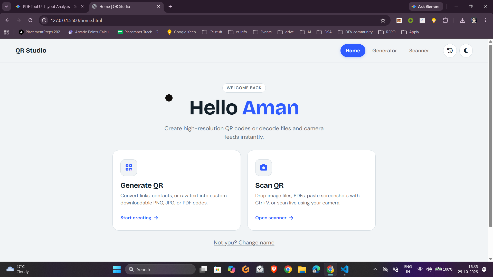
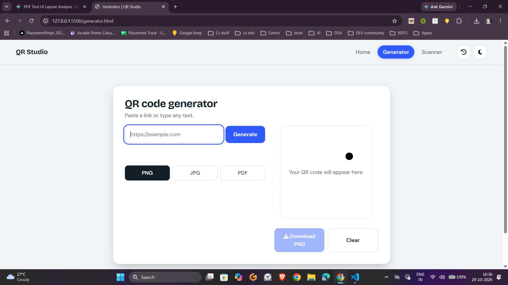
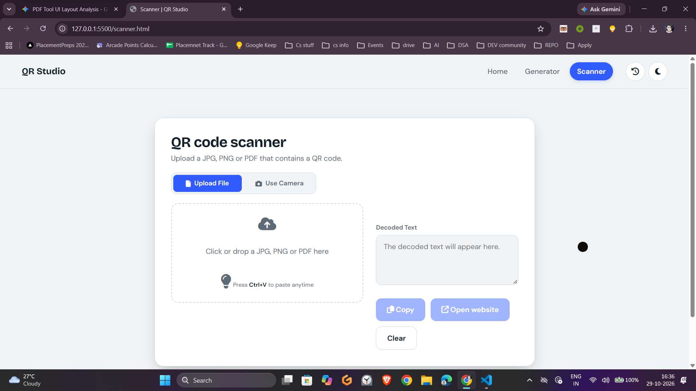
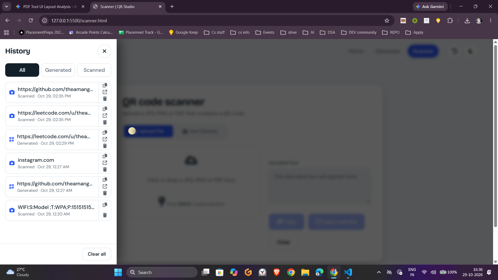

## 📸 App Previews

| Home Dashboard | QR Generator |
| :---: | :---: |
|  |  |

| QR Scanner | History Drawer |
| :---: | :---: |
|  |  |


## 📌 Project Overview

**QR Studio** is a modern, lightweight, client-side web application engineered for generating, customizing, and decoding QR codes directly inside the browser. Unlike conventional QR web utilities that depend on server-side databases or subscription-based APIs, QR Studio operates entirely locally on the user's device—eliminating latency, securing privacy, and ensuring sensitive payloads (credentials, contact data, private URLs) never leak to external servers.

---

## ⚡ Core Features

### 1. Dynamic QR Generator
* **Flexible Payload Input:** Encode standard plain text, website URLs, contact snippets, or credentials instantly.
* **Multi-Format Export Engine:** Download ready-to-use QR assets in raster formats (PNG, JPG) or package them directly into printable sheets using client-side PDF generation (`jsPDF`).
* **Input Validation & Sanitization:** Automatically sanitizes input and uses URL parameter encoding to guarantee valid payloads across different scanner devices.

### 2. Universal QR Scanner
* **Live Webcam / Device Camera:** Streams video feeds locally using the `MediaDevices API` and extracts frame pixels through an HTML5 Canvas to parse QR codes in real-time.
* **File & Document Scanning:** Drag, drop, or upload images (PNG, JPG, WebP) and multi-page PDF documents (`pdf.js`) to decode QR codes without needing a physical camera.
* **Instant Capture Feedback:** Delivers immediate tactile and sensory verification upon successful scan:
  * **Visual:** Green viewfinder reticle pulse animation.
  * **Audio:** High-frequency, dual-tone confirmation chime synthesized via the native Web Audio API (`AudioContext`).
  * **Haptics:** Device vibration feedback (`navigator.vibrate`) on supported mobile devices.
* **Contextual Actions:** One-click clipboard copy and direct website routing for detected URLs.

### 3. Local History & Session State
* **Client-Side History Drawer:** Tracks previously generated and scanned QR codes automatically using persistent `localStorage`.
* **Zero Backend Storage:** No cloud database or account registration required; users retain full ownership of their scanning history with one-click clear options.
* **Theme Preferences:** Synchronized dark and light theme controls that persist across sessions.

---

## 🛠️ Architecture & Technical Skills

| Layer / Domain | Technology / API | Purpose |
| :--- | :--- | :--- |
| **Markup & Layout** | HTML5 Semantic Elements | Multi-tab routing, accessible video viewports, and custom forms |
| **Styling & Effects** | CSS3 & Custom Properties | Split-grid desktop views, dark mode variables, and keyframe animations |
| **Logic & State** | Vanilla JavaScript (ES6+) | Asynchronous DOM handling, event listeners, and `localStorage` persistence |
| **Hardware & Devices** | `MediaDevices.getUserMedia()` | Live webcam access, frame rendering, and camera track lifecycle management |
| **Audio Synthesis** | Web Audio API (`AudioContext`) | In-browser oscillator chime generation without external audio files |
| **Decoding Engine** | `jsQR` | Client-side pattern recognition and pixel matrix scanning |
| **Document Processing**| `pdf.js` & `jsPDF` | Client-side PDF page rendering and printable QR export generation |
| **System Operations** | Clipboard API (`navigator.clipboard`) | Seamless OS clipboard copying for decoded results and payload text |

---

## 📂 Project Structure

```text
├── index.html              # Main application entry point & router
├── home.html               # Welcome dashboard & quick navigation
├── generator.html          # QR generator interface & export tools
├── scanner.html            # Live camera & file upload decoder
├── css/
│   └── style.css           # Global stylesheet, design system & animations
├── js/
│   ├── main.js             # Generator logic, tabs, theme, & history drawer
│   ├── scanner.js          # WebRTC camera feed, jsQR decoding & audio feedback
│   ├── jsqr.js             # Core barcode scanning library
│   ├── pdf.min.js          # PDF rendering engine
│   └── jspdf.umd.min.js    # Client-side PDF document generation
└── assets/
    └── screenshots/        # Application preview images